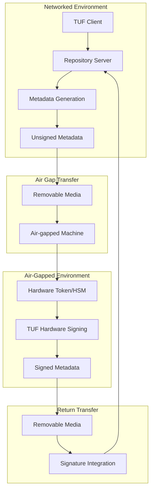

# Air-Gapped Hardware Signing for TUF .NET

This document provides comprehensive guidance for implementing air-gapped signing workflows using hardware security modules (HSMs) and hardware tokens with TUF .NET. Air-gapped signing is essential for protecting high-value cryptographic keys, especially TUF root keys, from network-based attacks.

## 🔒 Overview

Air-gapped signing involves physically isolating the key signing process from networked systems to maximize security. This approach is recommended for:

- **TUF Root Keys**: The foundation of TUF trust hierarchy
- **High-value signing operations**: Enterprise code signing, certificate authorities
- **Regulatory compliance**: FIPS 140-2, Common Criteria, SOX compliance
- **Critical infrastructure**: Systems requiring the highest security assurance

## 🏗️ Architecture



## 🔧 Prerequisites

### Hardware Requirements

**Recommended Hardware Tokens**:
- **YubiKey 5 FIPS**: FIPS 140-2 Level 2 certified, PIN + touch authentication
- **SafeNet eToken 5110 CC**: Common Criteria EAL5+ certified
- **Nitrokey HSM 2**: Open source HSM with high security

**Air-Gapped Machine Requirements**:
- Dedicated machine with no network connectivity
- USB ports disabled except during transfer operations
- Physical security controls (locked room, access logging)
- Tamper-evident seals for detecting unauthorized access

### Software Requirements

- **TUF .NET** with hardware signing support enabled
- **Pkcs11Interop** library for PKCS#11 device communication
- **Platform-specific PKCS#11 libraries**:
  - YubiKey: YKCS11 (libykcs11.so/dll)
  - SafeNet: eToken PKCS#11
  - Nitrokey: OpenSC PKCS#11

## 🚀 Setup Procedures

### 1. Air-Gapped Machine Preparation

```bash
# 1. Install required software (from verified media)
# Copy TUF .NET binaries and dependencies to air-gapped machine

# 2. Install PKCS#11 libraries
# Linux (YubiKey example):
sudo dpkg -i yubico-piv-tool_*.deb

# 3. Verify hardware token detection
dotnet run --project examples/HardwareSigning -- list-providers

# 4. Test hardware token connectivity
dotnet run --project examples/HardwareSigning -- test-connection --key-id "9c"
```

### 2. Hardware Token Configuration

**YubiKey PIV Setup**:
```bash
# Generate key pair on hardware token (performed once)
ykman piv keys generate 9c public.pem

# Create self-signed certificate
ykman piv certificates generate 9c public.pem \
  --subject "CN=TUF Root CA,O=Your Organization,C=US"

# Set PIN and PUK (Personal Unblocking Key)
ykman piv access change-pin
ykman piv access change-puk

# Enable touch requirement for signing (recommended)
ykman piv keys set-touch-policy 9c always
```

**Security Configuration Verification**:
```bash
# Verify key is stored in hardware and cannot be exported
ykman piv keys attest 9c attestation.pem

# Check PIN policy and touch requirements
ykman piv info

# Test signing operation requires physical presence
dotnet run --project examples/HardwareSigning -- sign \
  --key-id "9c" --data "test signing operation"
```

### 3. Transfer Media Preparation

**Recommended Transfer Media**:
- **Write-once optical media (DVD-R)**: Cannot be modified after writing
- **Hardware-encrypted USB drives**: With cryptographic authentication
- **Network-isolated dedicated drives**: With integrity verification

**Transfer Media Security**:
```bash
# Calculate cryptographic hashes for integrity verification
sha256sum metadata-to-sign.json > metadata.sha256
sha256sum signed-metadata.json > signed.sha256

# Encrypt sensitive data during transfer (optional additional protection)
gpg --symmetric --cipher-algo AES256 metadata-to-sign.json
```

## 📋 Operational Workflows

### Root Key Signing Workflow

This workflow demonstrates signing TUF root metadata, which requires the highest security:

#### Step 1: Metadata Preparation (Networked Environment)

```csharp
// Generate unsigned root metadata on networked machine
var rootMetadata = new Root
{
    Version = 2,
    Expires = DateTimeOffset.UtcNow.AddYears(1),
    Keys = new Dictionary<string, Key>
    {
        // Public keys for all TUF roles
        ["root-key-1"] = rootPublicKey,
        ["targets-key-1"] = targetsPublicKey,
        ["timestamp-key-1"] = timestampPublicKey
    },
    Roles = new Dictionary<string, Role>
    {
        ["root"] = new Role { KeyIds = ["root-key-1"], Threshold = 1 },
        ["targets"] = new Role { KeyIds = ["targets-key-1"], Threshold = 1 },
        ["timestamp"] = new Role { KeyIds = ["timestamp-key-1"], Threshold = 1 },
        ["snapshot"] = new Role { KeyIds = ["timestamp-key-1"], Threshold = 1 }
    }
};

// Serialize to canonical JSON for signing
var canonicalJson = CanonicalJsonSerializer.Serialize(rootMetadata);
await File.WriteAllTextAsync("root-metadata-unsigned.json", canonicalJson);

// Create cryptographic hash for transfer integrity
var hash = SHA256.HashData(Encoding.UTF8.GetBytes(canonicalJson));
await File.WriteAllTextAsync("root-metadata.sha256", Convert.ToHexString(hash));
```

#### Step 2: Transfer to Air-Gapped Environment

```bash
# Verify transfer media integrity
sha256sum -c root-metadata.sha256

# Copy files to air-gapped machine
cp root-metadata-unsigned.json /media/transfer/
cp root-metadata.sha256 /media/transfer/

# Physical transfer to air-gapped machine
# (Document transfer with signatures of authorized personnel)
```

#### Step 3: Signing Operation (Air-Gapped Environment)

```bash
# Verify file integrity on air-gapped machine
sha256sum -c root-metadata.sha256

# Perform hardware signing operation
dotnet run --project examples/HardwareSigning -- sign \
  --key-id "9c" \
  --data "$(cat root-metadata-unsigned.json)" \
  > root-signature.json

# The hardware token will require:
# 1. PIN entry for authentication
# 2. Physical touch for user presence confirmation
# 3. Signature will be generated within tamper-resistant hardware
```

#### Step 4: Signature Integration (Networked Environment)

```csharp
// Integrate hardware signature into TUF metadata
var unsignedMetadata = await File.ReadAllTextAsync("root-metadata-unsigned.json");
var signatureData = await File.ReadAllTextAsync("root-signature.json");
var signature = JsonSerializer.Deserialize<SignatureObject>(signatureData);

var signedMetadata = new Metadata<Root>
{
    Signed = JsonSerializer.Deserialize<Root>(unsignedMetadata),
    Signatures = new List<SignatureObject> { signature }
};

// Verify signature before deployment
var isValid = await VerifyMetadataSignature(signedMetadata);
if (!isValid)
    throw new InvalidOperationException("Hardware signature verification failed");

// Deploy to repository
await File.WriteAllTextAsync("repository/metadata/root.json", 
    CanonicalJsonSerializer.Serialize(signedMetadata));
```

### Threshold Signing Workflow

For enhanced security, multiple hardware tokens can be used for threshold signatures:

```bash
# Multiple signing operations on different air-gapped machines
# Each with its own hardware token and operator

# Machine 1 (Root Key 1):
dotnet run -- sign --key-id "9c" --data "$(cat metadata.json)" > signature1.json

# Machine 2 (Root Key 2):
dotnet run -- sign --key-id "9c" --data "$(cat metadata.json)" > signature2.json

# Machine 3 (Root Key 3):
dotnet run -- sign --key-id "9c" --data "$(cat metadata.json)" > signature3.json

# Integration (networked environment):
# Combine signatures to meet threshold requirements (e.g., 2-of-3)
```

### Routine Signing Operations

For non-root metadata that requires regular updates:

```bash
# Timestamp metadata signing (automated, but still secure)
# Can use less stringent air-gap procedures for operational efficiency

# 1. Generate batch of timestamp signatures
for i in {1..100}; do
  dotnet run -- sign --key-id "9d" \
    --data "timestamp-$i.json" > "timestamp-signature-$i.json"
done

# 2. Transfer batch back to networked environment
# 3. Use signatures for operational metadata updates
```

## 🛡️ Security Best Practices

### Physical Security

**Access Controls**:
- Limit air-gapped machine access to authorized personnel only
- Implement dual-person integrity for all signing operations
- Use tamper-evident seals on equipment when not in use
- Log all access attempts with video surveillance

**Environmental Security**:
- Locate air-gapped machines in secured facilities
- Use Faraday cage or TEMPEST-resistant rooms for highly sensitive operations
- Implement electromagnetic interference shielding
- Control temperature and humidity to prevent hardware degradation

### Operational Security

**PIN Management**:
```bash
# Use strong, random PINs
openssl rand -base64 12 | tr -d "=+/"  # Generate strong PIN

# Change PINs regularly
ykman piv access change-pin

# Never store PINs with hardware tokens
# Use password managers or physical storage in separate locations
```

**Key Backup and Recovery**:
```bash
# Create secure key backup (performed once during key generation)
# Use secret sharing for critical keys (Shamir's Secret Sharing)

# Export public key for verification purposes
ykman piv certificates export 9c root-public-cert.pem

# Create key usage audit trail
echo "$(date): Root key signature operation by $USER" >> /secure/audit.log
```

**Audit Logging**:
```bash
# Log all signing operations with:
# - Timestamp
# - Operator identity
# - Metadata being signed
# - Hardware token serial number
# - Success/failure status

# Example audit log entry:
echo "$(date -Iseconds): SIGN_SUCCESS: User=$USER, Token=12345678, KeyID=9c, Data=$(sha256sum metadata.json)" >> audit.log
```

### Technical Security

**Signature Verification**:
```csharp
// Always verify signatures before deployment
public static async Task<bool> VerifyHardwareSignature(
    string publicKeyPem, 
    ReadOnlySpan<byte> data, 
    string signatureHex)
{
    using var rsa = RSA.Create();
    rsa.ImportFromPem(publicKeyPem);
    
    var hash = SHA256.HashData(data);
    var signature = Convert.FromHexString(signatureHex);
    
    return rsa.VerifyHash(hash, signature, HashAlgorithmName.SHA256, RSASignaturePadding.Pss);
}
```

**Integrity Verification**:
```bash
# Verify all file transfers with cryptographic hashes
sha256sum metadata.json > metadata.sha256

# Use detached signatures for additional integrity
gpg --detach-sign metadata.json

# Verify both hash and signature
sha256sum -c metadata.sha256 && gpg --verify metadata.json.sig metadata.json
```

## 📊 Compliance Considerations

### FIPS 140-2 Compliance

**Level 1**: Software cryptographic modules
- Use software-based signing for development and testing only
- Not suitable for production root key operations

**Level 2**: Tamper-evident hardware (YubiKey 5 FIPS)
- Suitable for most enterprise TUF root key operations
- Provides tamper evidence and role-based authentication

**Level 3**: Tamper-resistant hardware (Enterprise HSMs)
- Required for highly regulated environments
- Provides tamper resistance and environmental failure protection

**Level 4**: Tamper-responsive hardware
- Required for the most critical government and financial applications
- Provides active tamper response with key zeroization

### Common Criteria Evaluation

**EAL4+**: Most hardware tokens (YubiKey, SafeNet eToken)
- Methodically designed, tested, and reviewed
- Suitable for commercial and government applications

**EAL5+**: High-assurance hardware tokens
- Methodically designed and tested
- Required for high-security government applications

### Documentation Requirements

**Operational Documentation**:
- Detailed signing procedures with step-by-step instructions
- Emergency procedures for hardware token failure or compromise
- Key recovery procedures with multiple authorization requirements
- Regular audit and compliance verification procedures

**Technical Documentation**:
- Hardware token configuration specifications
- Air-gapped environment security controls
- Network isolation verification procedures
- Cryptographic algorithm specifications and justifications

## 🚨 Incident Response

### Hardware Token Compromise

```bash
# Immediate Response:
# 1. Revoke all signatures created with compromised token
# 2. Generate new root metadata with new keys
# 3. Update trust anchors in all client applications
# 4. Conduct forensic analysis to determine compromise scope

# Recovery Procedure:
# 1. Generate new hardware token with fresh key material
# 2. Create new root metadata with updated keys
# 3. Sign new root metadata with remaining threshold keys
# 4. Distribute new trust anchors through secure channels
```

### Air-Gap Breach Detection

```bash
# Signs of potential air-gap breach:
# - Unexpected network activity on air-gapped machine
# - Unauthorized files or software modifications
# - Hardware token access outside authorized windows
# - Anomalous signature operations in audit logs

# Response procedures:
# 1. Immediately isolate affected systems
# 2. Perform full forensic imaging before any remediation
# 3. Assess extent of compromise and data exposure
# 4. Execute key rotation procedures if compromise confirmed
```

### Business Continuity

**Backup Hardware Tokens**:
- Maintain multiple hardware tokens with identical key material
- Store backup tokens in geographically separated secure locations
- Test backup token functionality regularly

**Alternative Signing Procedures**:
- Document emergency signing procedures using backup methods
- Maintain threshold signature capabilities with distributed tokens
- Plan for temporary certificate extensions during recovery operations

## 📚 References and Standards

### Security Standards
- **FIPS 140-2**: Security Requirements for Cryptographic Modules
- **Common Criteria**: Information Technology Security Evaluation
- **NIST SP 800-57**: Recommendation for Key Management
- **ISO 27001**: Information Security Management Systems

### TUF Security Documentation
- [TUF Security Design](https://theupdateframework.io/docs/1.0.0/security/)
- [TUF Threat Model](https://theupdateframework.io/docs/1.0.0/threat-model/)
- [TUF Best Practices](https://theupdateframework.io/docs/1.0.0/best-practices/)

### Hardware Security Resources
- [PKCS#11 Cryptographic Token Interface Standard](https://docs.oasis-open.org/pkcs11/pkcs11-base/v2.40/)
- [YubiKey PIV Application Guide](https://developers.yubico.com/PIV/)
- [SafeNet Authentication Documentation](https://cpl.thalesgroup.com/encryption/hardware-security-modules)

## 🎯 Implementation Checklist

### Initial Setup
- [ ] Procure FIPS 140-2 Level 2+ hardware tokens
- [ ] Set up dedicated air-gapped signing environment
- [ ] Install and configure TUF .NET hardware signing capabilities
- [ ] Generate root key pairs on hardware tokens
- [ ] Test signing workflow with non-production data
- [ ] Document all procedures and train authorized personnel

### Operational Procedures
- [ ] Implement dual-person integrity for all root key operations
- [ ] Establish PIN management and rotation procedures
- [ ] Configure comprehensive audit logging
- [ ] Test signature verification workflows
- [ ] Validate threshold signature procedures
- [ ] Create emergency response procedures

### Compliance and Auditing
- [ ] Document security controls and procedures
- [ ] Implement regular compliance audits
- [ ] Establish key rotation schedules
- [ ] Create incident response playbooks
- [ ] Train personnel on security procedures
- [ ] Establish ongoing security monitoring

### Continuous Improvement
- [ ] Regular security assessments and penetration testing
- [ ] Hardware token firmware update procedures
- [ ] Security control effectiveness reviews
- [ ] Emergency response exercise and testing
- [ ] Documentation updates and procedure refinements

---

Air-gapped hardware signing represents the gold standard for protecting high-value cryptographic operations in TUF deployments. While complex to implement, it provides the highest assurance against both network-based and physical attacks, making it essential for protecting the root of trust in critical software update infrastructures.