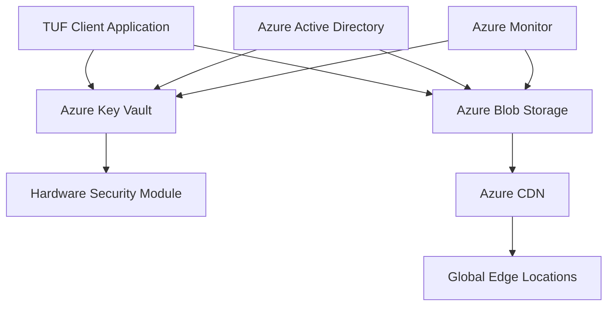

# Azure Integration for TUF .NET

This example demonstrates enterprise-grade TUF integration using Microsoft Azure cloud services, providing HSM-backed signing and globally distributed repository storage.

## Overview

The Azure Integration example showcases how TUF .NET can leverage Azure's enterprise cloud infrastructure to deliver production-ready secure software update systems. This implementation provides:

- **🔐 Azure Key Vault Integration**: HSM-backed cryptographic operations with enterprise security
- **☁️ Azure Blob Storage Backend**: Globally distributed repository storage with CDN capabilities  
- **🛡️ Enterprise Security**: Complete audit trails, IAM integration, and compliance features
- **🌍 Global Distribution**: Multi-region availability and edge distribution
- **💼 Production Ready**: Comprehensive error handling, logging, and operational guidance

## Architecture



## Key Components

### AzureKeyVaultSigner

HSM-backed TUF signer implementation that ensures private keys never leave Azure's security boundary.

**Features:**
- Hardware Security Module (HSM) protection
- FIPS 140-2 Level 2 validated security
- Complete cryptographic operation audit trails
- Support for RSA-2048, RSA-3072, RSA-4096 with RSASSA-PSS-SHA256
- Azure AD integration for identity-based access control
- Cross-region high availability

**Security Benefits:**
- Private keys never exported from Azure Key Vault
- All signing operations performed in HSM hardware  
- Granular access control with Azure RBAC
- Comprehensive logging of all cryptographic operations
- Built-in key rotation and lifecycle management

### AzureBlobRepositoryBackend

Enterprise storage backend providing global distribution and advanced security features.

**Features:**
- 99.999999999% (11 9's) data durability
- Global content distribution via Azure CDN
- Server-side encryption with customer-managed keys
- Lifecycle management and cost optimization
- Object versioning and soft delete protection
- Private endpoint network isolation

**Performance Characteristics:**
- Hot tier: Optimized for metadata (frequent access)
- Cool tier: Cost-optimized for large target files
- Archive tier: Long-term retention at lowest cost
- Intelligent tiering: Automatic cost optimization

## Prerequisites

### Azure Resources

1. **Azure Key Vault**
   - Premium tier (required for HSM operations)
   - RSA key created with appropriate size (2048, 3072, or 4096 bits)
   - Access policies configured for your identity

2. **Azure Storage Account**
   - General Purpose v2 (recommended)
   - Blob storage with public access (for repository hosting)
   - Optional: Azure CDN for global distribution

3. **Azure Active Directory**
   - Service principal or managed identity for authentication
   - Appropriate role assignments for Key Vault and Storage

### Development Environment

- .NET 10.0 or later
- Azure CLI (for local development authentication)
- Visual Studio or VS Code with Azure extensions (recommended)

## Quick Start

### 1. Set up Azure Resources

```bash
# Create resource group
az group create --name tuf-azure-demo --location eastus

# Create Key Vault
az keyvault create --name my-tuf-keyvault --resource-group tuf-azure-demo

# Create RSA key in Key Vault
az keyvault key create --vault-name my-tuf-keyvault --name tuf-signing-key --kty RSA --size 3072

# Create Storage Account
az storage account create --name mytufstorageaccount --resource-group tuf-azure-demo --sku Standard_LRS

# Create Blob Container
az storage container create --account-name mytufstorageaccount --name tuf-repository --public-access blob
```

### 2. Configure Authentication

For local development, use Azure CLI:
```bash
az login
az account set --subscription "your-subscription-id"
```

For production, use managed identities or service principals.

### 3. Build and Run

```bash
# Build the project
dotnet build

# Run Azure Key Vault demo
dotnet run -- keyvault-demo --key-vault-uri "https://my-tuf-keyvault.vault.azure.net/" --key-name "tuf-signing-key"

# Run Azure Blob Storage demo  
dotnet run -- blob-demo --storage-account "mytufstorageaccount" --container-name "tuf-repository"

# Run complete workflow
dotnet run -- full-workflow \
  --key-vault-uri "https://my-tuf-keyvault.vault.azure.net/" \
  --key-name "tuf-signing-key" \
  --storage-account "mytufstorageaccount" \
  --container-name "tuf-repository"
```

## Usage Examples

### Basic Key Vault Signing

```csharp
// Create Azure Key Vault signer
var signer = new AzureKeyVaultSigner(
    new Uri("https://my-keyvault.vault.azure.net/"), 
    "my-signing-key"
);

// Sign data using HSM
var data = "Data to be signed"u8.ToArray();
var signature = signer.SignBytes(data);

Console.WriteLine($"Signed with Key ID: {signature.KeyId.Value}");
```

### Repository Operations with Blob Storage

```csharp
// Create blob storage backend
var backend = new AzureBlobRepositoryBackend(
    "mystorageaccount", 
    "tuf-repository"
);

// Upload metadata
var metadata = """{"version": 1, "expires": "2025-12-31T00:00:00Z"}""";
var metadataBytes = Encoding.UTF8.GetBytes(metadata);
var uri = await backend.UploadFileAsync("metadata/root.json", metadataBytes);

// Download and verify
var downloaded = await backend.DownloadFileAsync("metadata/root.json");
var exists = await backend.FileExistsAsync("metadata/root.json");
```

### Complete TUF Workflow

```csharp
// Initialize Azure services
var signer = new AzureKeyVaultSigner(keyVaultUri, keyName);
var backend = new AzureBlobRepositoryBackend(storageAccount, container);

// Create TUF metadata
var rootMetadata = new Root 
{
    SpecVersion = "1.0.0",
    Version = 1,
    Expires = DateTimeOffset.UtcNow.AddYears(1),
    // ... configure roles and keys
};

// Sign with Azure Key Vault
var signedRoot = new Metadata<Root> { Signed = rootMetadata };
signedRoot.Sign(signer);

// Upload to Azure Blob Storage
var jsonBytes = CanonicalJsonSerializer.Serialize(signedRoot);
await backend.UploadFileAsync("metadata/root.json", jsonBytes);
```

## Production Deployment

### Infrastructure as Code

#### Azure Resource Manager (ARM) Template

```json
{
  "$schema": "https://schema.management.azure.com/schemas/2019-04-01/deploymentTemplate.json#",
  "contentVersion": "1.0.0.0",
  "resources": [
    {
      "type": "Microsoft.KeyVault/vaults",
      "apiVersion": "2021-11-01-preview",
      "name": "[variables('keyVaultName')]",
      "properties": {
        "sku": { "name": "premium", "family": "A" },
        "tenantId": "[subscription().tenantId]",
        "enablePurgeProtection": true,
        "enableSoftDelete": true
      }
    },
    {
      "type": "Microsoft.Storage/storageAccounts",
      "apiVersion": "2021-09-01",
      "name": "[variables('storageAccountName')]",
      "properties": {
        "kind": "StorageV2",
        "accessTier": "Hot",
        "minimumTlsVersion": "TLS1_2"
      }
    }
  ]
}
```

#### Bicep Template

```bicep
param location string = resourceGroup().location
param keyVaultName string
param storageAccountName string

resource keyVault 'Microsoft.KeyVault/vaults@2021-11-01-preview' = {
  name: keyVaultName
  location: location
  properties: {
    sku: { name: 'premium', family: 'A' }
    tenantId: subscription().tenantId
    enablePurgeProtection: true
    enableSoftDelete: true
    enableRbacAuthorization: true
  }
}

resource storageAccount 'Microsoft.Storage/storageAccounts@2021-09-01' = {
  name: storageAccountName
  location: location
  kind: 'StorageV2'
  sku: { name: 'Standard_GRS' }
  properties: {
    accessTier: 'Hot'
    minimumTlsVersion: 'TLS1_2'
    supportsHttpsTrafficOnly: true
  }
}
```

### Security Configuration

#### Key Vault Access Policies

```bash
# Grant application permissions to Key Vault
az keyvault set-policy \
  --name my-tuf-keyvault \
  --object-id $APPLICATION_OBJECT_ID \
  --key-permissions sign verify get list \
  --secret-permissions get list
```

#### Storage Account Security

```bash
# Configure storage account firewall
az storage account update \
  --name mytufstorageaccount \
  --default-action Deny

# Allow specific virtual networks
az storage account network-rule add \
  --account-name mytufstorageaccount \
  --vnet-name production-vnet \
  --subnet-name tuf-subnet
```

### Monitoring and Logging

#### Azure Monitor Integration

```csharp
// Configure structured logging
services.AddLogging(builder =>
{
    builder.AddApplicationInsights();
    builder.AddAzureWebAppDiagnostics();
});

// Add Application Insights telemetry
services.AddApplicationInsightsTelemetry();
```

#### Key Metrics to Monitor

- **Key Vault Operations**: Sign operations, success rate, latency
- **Storage Operations**: Upload/download throughput, error rates
- **Security Events**: Authentication failures, unauthorized access attempts
- **Performance**: End-to-end operation latency, cache hit rates

## Cost Optimization

### Storage Tiering Strategy

```csharp
// Configure lifecycle management for cost optimization
var options = new BlobUploadOptions
{
    // Metadata files: Hot tier for frequent access
    AccessTier = path.StartsWith("metadata/") ? AccessTier.Hot : AccessTier.Cool,
    
    // Configure automatic archival for old versions
    Metadata = new Dictionary<string, string>
    {
        ["lifecycle-policy"] = "archive-after-90-days"
    }
};
```

### Key Vault Usage Optimization

- Use single key for multiple operations when security permits
- Implement signature caching for identical data
- Batch operations when possible to reduce transaction costs
- Monitor HSM operation costs and optimize key rotation schedules

## Troubleshooting

### Common Issues

#### Authentication Failures
```
Error: Azure.RequestFailedException: The user, group or application does not have access
```
**Solution**: Verify Azure AD permissions and Key Vault access policies.

#### Storage Access Denied
```
Error: This request is not authorized to perform this operation
```
**Solution**: Check storage account permissions and network access rules.

#### Key Not Found
```
Error: Key not found: tuf-signing-key
```
**Solution**: Verify key exists and your credentials have access to it.

### Debugging Tools

```bash
# Test Key Vault connectivity
az keyvault key show --vault-name my-tuf-keyvault --name tuf-signing-key

# Test Storage Account access
az storage blob list --account-name mytufstorageaccount --container-name tuf-repository

# Check Azure AD authentication
az account show
az ad signed-in-user show
```

### Performance Optimization

#### Caching Strategies

```csharp
// Implement metadata caching to reduce storage calls
private readonly MemoryCache _metadataCache = new();

public async Task<byte[]?> GetCachedMetadataAsync(string path)
{
    if (_metadataCache.TryGetValue(path, out byte[]? cached))
        return cached;

    var data = await backend.DownloadFileAsync(path);
    if (data != null)
    {
        _metadataCache.Set(path, data, TimeSpan.FromMinutes(5));
    }
    
    return data;
}
```

#### Connection Pooling

```csharp
// Configure HTTP client for optimal performance
services.Configure<BlobClientOptions>(options =>
{
    options.Transport = new HttpClientTransport(new HttpClient(new SocketsHttpHandler
    {
        PooledConnectionLifetime = TimeSpan.FromMinutes(15),
        MaxConnectionsPerServer = 50
    }));
});
```

## Security Considerations

### Network Security

- Use private endpoints for Key Vault and Storage Account access
- Implement IP restrictions and virtual network integration
- Enable Azure DDoS Protection for public-facing storage endpoints

### Data Protection

- Enable soft delete and versioning on storage accounts
- Use customer-managed keys for additional encryption control
- Implement backup strategies for critical metadata

### Access Control

- Follow principle of least privilege for service identities
- Implement conditional access policies for human administrators
- Regular audit of access logs and permissions

## Integration Examples

### ASP.NET Core Web Application

```csharp
// Configure services
services.AddSingleton<AzureKeyVaultSigner>(provider =>
{
    var config = provider.GetService<IConfiguration>();
    return new AzureKeyVaultSigner(
        new Uri(config["AzureKeyVault:Uri"]), 
        config["AzureKeyVault:KeyName"]
    );
});

services.AddSingleton<AzureBlobRepositoryBackend>(provider =>
{
    var config = provider.GetService<IConfiguration>();
    return new AzureBlobRepositoryBackend(
        config["AzureStorage:AccountName"],
        config["AzureStorage:ContainerName"]
    );
});
```

### Azure Functions

```csharp
[FunctionName("SignMetadata")]
public async Task<IActionResult> SignMetadata(
    [HttpTrigger(AuthorizationLevel.Function)] HttpRequest req,
    [Inject] AzureKeyVaultSigner signer,
    ILogger log)
{
    // Function implementation
}
```

### Container Deployment

```dockerfile
FROM mcr.microsoft.com/dotnet/aspnet:10.0
WORKDIR /app
COPY . .

# Configure managed identity for Azure authentication
ENV AZURE_CLIENT_ID="your-managed-identity-client-id"

EXPOSE 80
ENTRYPOINT ["dotnet", "AzureIntegration.dll"]
```

## Compliance and Auditing

### FIPS 140-2 Compliance

Azure Key Vault Premium tier provides FIPS 140-2 Level 2 validated HSMs, ensuring compliance with federal security requirements.

### SOC 2 Compliance

Both Azure Key Vault and Azure Storage are SOC 2 Type II compliant, providing assurance for enterprise security controls.

### Audit Logging

All operations are automatically logged to Azure Monitor, providing comprehensive audit trails for compliance requirements.

## Resources

- [Azure Key Vault Documentation](https://docs.microsoft.com/en-us/azure/key-vault/)
- [Azure Blob Storage Documentation](https://docs.microsoft.com/en-us/azure/storage/blobs/)
- [TUF Specification](https://theupdateframework.io/specification/)
- [Azure Security Best Practices](https://docs.microsoft.com/en-us/azure/security/fundamentals/)

## Support

For issues specific to this Azure integration example:
1. Check the troubleshooting section above
2. Review Azure service health and status pages
3. Enable diagnostic logging for detailed error information
4. Consult the TUF .NET project documentation and issues

For Azure-specific support:
- Azure Support Plans
- Azure Community Forums  
- Microsoft Q&A Platform