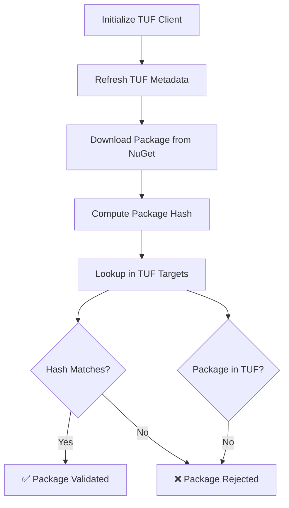

# TUF + NuGet Integration Example

This example demonstrates how to integrate TUF (The Update Framework) with NuGet to provide secure package management and supply chain attack protection for .NET applications.

## Overview

The NuGet ecosystem faces significant supply chain security challenges, including:
- Malicious packages (e.g., event-stream, ua-parser-js incidents)
- Typosquatting attacks
- Dependency confusion attacks
- Package tampering and injection
- Compromised maintainer accounts

This example shows how TUF can mitigate these risks by providing:
- **Package integrity verification** - Cryptographic hashes ensure packages haven't been modified
- **Rollback attack prevention** - Version metadata prevents downgrade to vulnerable versions
- **Trusted metadata distribution** - Signed metadata prevents unauthorized package additions
- **Secure key management** - Proper key rotation and threshold signatures

## Features

### 🔒 Security Features
- **Supply Chain Protection**: Validates all packages against TUF metadata before installation
- **Hash Verification**: Computes and verifies SHA256 hashes of package files
- **Metadata Validation**: Ensures package metadata integrity using TUF's signed metadata
- **Rollback Prevention**: Prevents installation of packages not in current TUF metadata

### 🛠️ Technical Features
- **NuGet Protocol Integration**: Uses official NuGet.Protocol library for package operations
- **Command Line Interface**: Easy-to-use CLI for package validation
- **Demonstration Mode**: Interactive demo explaining TUF concepts and benefits
- **Production Ready**: AOT-compatible code following .NET best practices

## Usage

### Prerequisites
- .NET 8.0 or later
- Access to a TUF metadata repository
- Internet connection for NuGet package downloads

### Build and Run

```bash
# Build the example
cd examples/NuGetIntegration
dotnet build

# Run the interactive demo
dotnet run demo

# Validate a specific package
dotnet run validate --package-id Newtonsoft.Json --version 13.0.3 --tuf-metadata https://example.com/tuf/metadata

# Show help
dotnet run --help
```

### Command Options

#### `validate` command
- `--package-id`: NuGet package ID to validate (required)
- `--version`: Package version to validate (required)
- `--source`: NuGet package source URL (default: https://api.nuget.org/v3/index.json)
- `--tuf-metadata`: TUF metadata repository URL (required)

#### `demo` command
Runs an interactive demonstration showing:
1. TUF metadata structure for NuGet integration
2. Package validation workflow
3. Security benefits and attack prevention

## How It Works

### 1. TUF Metadata Structure

The example integrates with TUF's four key metadata files:

```
root.json      - Contains trusted signing keys and role definitions
timestamp.json - Prevents freeze attacks, references snapshot.json
snapshot.json  - Prevents mix-and-match attacks, references targets.json  
targets.json   - Contains NuGet package hashes and metadata
```

For NuGet integration, `targets.json` contains entries like:

```json
{
  "signed": {
    "targets": {
      "Newtonsoft.Json.13.0.3.nupkg": {
        "length": 705442,
        "hashes": {
          "sha256": "0f085ce78b8bd611ae45e1dd7e9b79d25321e7e49e67adb65c70b91b22a5a7cf"
        }
      }
    }
  }
}
```

### 2. Validation Workflow



### 3. Security Benefits

| Attack Type | How TUF Prevents It |
|-------------|-------------------|
| **Malicious Packages** | Only packages in signed TUF metadata are trusted |
| **Rollback Attacks** | TUF prevents downgrade to older, vulnerable versions |
| **Freeze Attacks** | Timestamp metadata has expiration dates |
| **Mix-and-Match** | Snapshot metadata ensures consistency across all metadata |
| **Tampering** | Package hashes must match TUF metadata exactly |
| **Typosquatting** | Only explicitly approved packages are installable |

## Integration Scenarios

### 1. Corporate Package Registry

```csharp
// Configure TUF for internal NuGet feed
var config = new UpdaterConfig(
    corporateTrustedRoot, 
    new Uri("https://internal-nuget.company.com/tuf/metadata"))
{
    LocalMetadataDir = GetCorporateMetadataCache(),
    LocalTargetsDir = GetCorporateTargetsCache(),
    Client = CreateAuthenticatedHttpClient()
};
```

### 2. CI/CD Pipeline Integration

```yaml
# Azure DevOps pipeline step
- task: DotNetCoreCLI@2
  displayName: 'Validate NuGet packages with TUF'
  inputs:
    command: 'custom'
    custom: 'run'
    projects: 'tools/NuGetValidator/NuGetValidator.csproj'
    arguments: 'validate --package-list packages.txt --tuf-metadata $(TUF_METADATA_URL)'
```

### 3. Visual Studio Extension

The validation logic can be integrated into Visual Studio as an extension that:
- Validates packages during `Add Package` operations
- Shows security status in Package Manager UI
- Warns users about unvalidated packages
- Integrates with .NET's existing NuGetAudit features

## Production Considerations

### Trusted Root Management

In production, the trusted root should be:

1. **Embedded at build time**: Include in application resources
2. **Distributed securely**: Through signed installers or secure channels  
3. **Regularly rotated**: Following TUF key management best practices
4. **Centrally managed**: By package registry operators (NuGet.org, etc.)

### Performance Optimization

- **Metadata Caching**: Cache TUF metadata locally to reduce network requests
- **Background Updates**: Refresh metadata asynchronously
- **Batch Validation**: Validate multiple packages in parallel
- **Hash Precomputation**: Store package hashes to avoid recomputation

### Error Handling

```csharp
try
{
    await ValidatePackageWithTuf(package);
}
catch (TufMetadataNotFoundException)
{
    // Package not in TUF - decide whether to allow or block
}
catch (TufHashMismatchException)
{
    // Package tampered - always block
    throw new SecurityException("Package integrity check failed");
}
catch (TufExpiredMetadataException)
{
    // Metadata expired - refresh and retry
    await RefreshTufMetadata();
}
```

## Related Examples

- **BasicClient**: Basic TUF client implementation
- **SigningDemo**: Digital signing examples
- **MultiRepositoryClient**: Multi-repository TUF scenarios

## References

- [TUF Specification](https://theupdateframework.github.io/specification/latest/)
- [NuGet Client SDK](https://docs.microsoft.com/en-us/nuget/reference/nuget-client-sdk)
- [Supply Chain Security Best Practices](https://slsa.dev/)
- [.NET Security Guidelines](https://docs.microsoft.com/en-us/dotnet/standard/security/)

## Contributing

This example demonstrates core concepts and can be extended with:
- MSBuild integration for automated validation
- PowerShell module for package management
- ASP.NET Core middleware for server-side validation
- Azure DevOps / GitHub Actions integration
- Visual Studio Code extension

For questions or contributions, please see the main [TUF .NET repository](../../README.md).